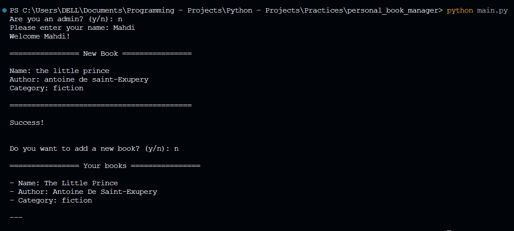
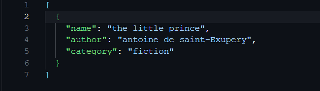
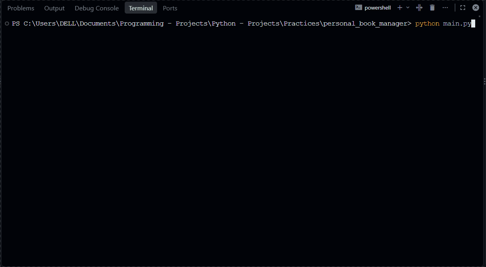

# Personal Book Manager


A simple command-line application built with Python for keeping a personal library of books. Users can add books by entering each book's name, author, and category. The application displays the saved library and stores book records locally in a JSON file so they are available the next time the program runs.

The project also includes a basic password check for an admin mode. The admin password is loaded from an environment variable rather than being written directly in the source code.

## Table of Contents

- [Personal Book Manager](#personal-book-manager)
  - [Table of Contents](#table-of-contents)
  - [Description](#description)
  - [Features](#features)
  - [Project Structure](#project-structure)
  - [File Description](#file-description)
  - [Requirements](#requirements)
  - [Installation](#installation)
  - [Environment Setup](#environment-setup)
  - [Usage](#usage)
    - [Normal user mode](#normal-user-mode)
    - [Admin mode](#admin-mode)
  - [Example Output](#example-output)
  - [Screenshots](#screenshots)
    - [Application Running](#application-running)
    - [Books Library](#books-library)
  - [Demo](#demo)
  - [Data Storage](#data-storage)
  - [Roadmap](#roadmap)
  - [Contributing](#contributing)
  - [License](#license)
  - [Author](#author)

## Description

**Personal Book Manager** is a terminal-based Python application for creating and viewing a personal book collection.

In normal user mode, the application asks for the user's name, loads previously saved books, and provides a prompt to add books. For every book, the user enters:

- Book name
- Author
- Category

The application checks that none of these fields is empty. After the user finishes adding books, the current collection is displayed and saved to `books.json`.

A separate admin entry path asks for a password. The password is read from the `BOOKMANAGERADMINPASSWORD` environment variable. At this stage, successful authentication only displays a confirmation message; additional admin features are not implemented yet.

## Features

- Ask for the user's name and display a welcome message.
- Add books by entering a name, author, and category.
- Validate book details and reject empty fields.
- Display the books currently in the collection.
- Save book records locally in `books.json`.
- Load previously saved book records when the application starts.
- Check a password before activating the basic admin mode.
- Keep the admin password outside the Python source code by using an environment variable.

## Project Structure

The core files used by the current implementation are:

```text
Personal-Book-Manager/
├── gifs/
│   └── demo.gif
├── pictures/
│   ├── app-running.png
│   └── books-library.png
├── main.py
├── books.py
├── books.json          # Created by the application when books are saved
├── .env                # Local configuration; do not commit
├── .env.example        # Optional template for environment configuration
├── requirements.txt
├── .gitignore
└── README.md
```

`books.json` and `.env` are local runtime/configuration files. They may not exist until you create or run the application. The `.env.example`, `requirements.txt`, and `.gitignore` entries should be included in the repository if you use those files in your setup.

## File Description

| File | Purpose |
| --- | --- |
| `main.py` | Starts the application, handles user input, validates new book details, and controls the user/admin entry paths. |
| `books.py` | Defines the `Bookshelf` class, which displays, saves, and loads book records. |
| `books.json` | Stores the book collection as JSON. It is created or updated when the application saves the collection. |
| `.env` | Holds the local admin-password environment variable. Keep this file private and out of Git. |
| `.env.example` | Optional template showing the required environment-variable name without containing a real password. |
| `requirements.txt` | Lists the external Python dependency required by the application. |
| `.gitignore` | Keeps local configuration and generated data files out of version control. |
| `pictures/` | Contains real screenshots of the application for the README. |
| `gifs/demo.gif` | Short GIF showing a real application run. |
| `README.md` | Documents the project and explains how to install and run it. |

## Requirements

- Python 3.12 or newer.
- `python-dotenv`.

Python 3.12 is specified because the current `books.py` code uses the Python 3.12 f-string grammar for expressions containing quoted dictionary keys.

## Installation

1. Clone the repository:

   ```bash
   git clone https://github.com/ejlalpourmahdi/Personal-Book-Manager.git
   ```

2. Move into the project directory:

   ```bash
   cd Personal-Book-Manager
   ```

3. Install the dependency:

   ```bash
   python -m pip install -r requirements.txt
   ```

   If you do not have a `requirements.txt` file yet, install the dependency directly:

   ```bash
   python -m pip install python-dotenv
   ```

4. Configure the environment variable as described in the next section.

## Environment Setup

The application reads the admin password from this environment variable:

```dotenv
BOOKMANAGERADMINPASSWORD=your_test_password
```

To use a local `.env` file:

1. Create a file named `.env` in the project root.
2. Add the variable shown above and replace the placeholder with a test password.
3. Make sure `.env` is included in `.gitignore`.

If you keep an `.env.example` file in the repository, it should contain only a placeholder:

```dotenv
BOOKMANAGERADMINPASSWORD=your_password_here
```

Do not commit `.env` or use a password from a personal account. The current program loads `.env` with `python-dotenv`.

## Usage

Run the application from the project directory:

```bash
python main.py
```

At the first prompt, choose an entry path:

- Enter `n` to use the book manager.
- Enter `y` to attempt to enter admin mode.

### Normal user mode

When you choose `n`, the application:

1. Asks for your name and displays a welcome message.
2. Loads any existing records from `books.json`.
3. Prompts you to enter a book's name, author, and category.
4. Rejects a book if any of those fields is empty.
5. Asks whether you want to add another book.
6. Displays the collection and saves it to `books.json`.

### Admin mode

When you choose `y`, the application asks for the admin password. If it matches `BOOKMANAGERADMINPASSWORD`, the program prints `Admin mode activated.` Otherwise, it prints an access-denied message.

**Note:** Admin authentication is currently the only implemented admin-mode behavior. No separate admin dashboard or book-management actions are available yet.

## Example Output

The following is an illustrative example. Exact prompts and output may vary slightly depending on the application version.

```text
Are you an admin? (y/n): n
Please enter your name: Mahdi
Welcome Mahdi!

================ New Book ================

Name: The Little Prince
Author: Antoine de Saint-Exupery
Category: Fiction

==========================================

Success!

Do you want to add a new book? (y/n): n

================ Your books ================

- Name: The Little Prince
- Author: Antoine De Saint-Exupery
- Category: Fiction

---
```

## Screenshots

Some picture of application run

### Application Running



### Books Library



## Demo

A short GIF of a real application run



## Data Storage

Book records are stored in `books.json` in the project directory. The file contains a JSON list of book objects. Each object has three fields:

```json
{
  "name": "The Little Prince",
  "author": "Antoine de Saint-Exupery",
  "category": "Fiction"
}
```

When the application starts, it loads the existing list. When the user finishes the input loop, the application saves the current list. If `books.json` does not exist yet, the application starts with an empty collection.

Keep `books.json` out of version control if it contains personal library information. If you want to share sample data, use a separate file containing fictional or non-personal examples.

## Roadmap

The following items are possible future improvements and are not part of the current implementation:

- [ ] Add the ability to search books by name, author, or category.
- [ ] Add the ability to edit book details.
- [ ] Add the ability to delete books.
- [ ] Implement admin actions after successful authentication.
- [ ] Improve input handling for invalid menu responses.
- [ ] Add automated tests for book validation and JSON storage.
- [ ] Add clearer error handling for invalid or corrupted JSON data.
- [ ] Add book sorting and filtering options.

## Contributing

Contributions and suggestions are welcome. If you would like to contribute, consider opening an issue to describe the proposed change before submitting a pull request.

## License

No license has been specified for this project yet.

## Author

**MohammadMahdi Ejlalpour**

- GitHub: [@ejlalpourmahdi](https://github.com/ejlalpourmahdi)
